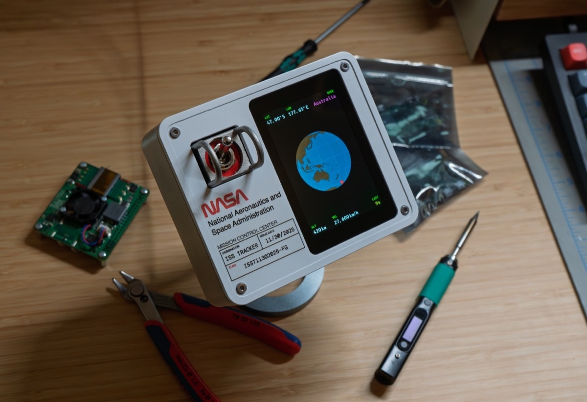

# ISS Tracker Display

A Raspberry Pi display that tracks the International Space Station in real time. It shows a rotating 3D globe with the ISS position and live telemetry on a 3.5" screen, and can switch to a list of everyone currently in space.



**How hard is it?** You'll type a few commands into a terminal and wait for some installs. The screen plugs straight onto the Pi, so there's no wiring unless you add the optional toggle switch. No API keys or accounts are needed.

## Features

- A spinning 3D globe with a marker that follows the ISS
- Live latitude, longitude, altitude, speed, the region below, and how fresh the data is
- A People in Space view listing every astronaut in orbit and their spacecraft
- An optional toggle switch to flip between the two views
- Runs 24/7: starts on boot and restarts itself if anything goes wrong

---

## What you'll need

| Part | Notes |
|------|-------|
| **Raspberry Pi** | Model 3B or newer |
| **microSD card** | 8 GB or larger, with Raspberry Pi OS **Bookworm or newer** installed using [Raspberry Pi Imager](https://www.raspberrypi.com/software/). Older versions don't have the Python 3.11 this app needs. |
| **Display** | [Waveshare 3.5" RPi LCD **(F)**](https://www.waveshare.com/3.5inch-rpi-lcd-f.htm), 320x480. Get the (F) specifically: other models, such as the (A), use a different display chip and won't work. |
| **Power supply** | The **official Raspberry Pi supply** for your model (5.1 V). Generic phone chargers make the globe stutter; see [Power supply](#power-supply) for why. |
| **Toggle switch** *(optional)* | A latching (on/off) switch wired between GPIO 17 and GND to switch views |

---

## Setup

Run the commands below in a terminal on the Pi, either directly with a keyboard and monitor or over SSH from another computer.

### 1. Turn on SPI

SPI is the connection the Pi uses to talk to the display. Open the configuration tool:

```bash
sudo raspi-config
```

Go to **Interface Options**, then **SPI**, and choose **Yes** to enable it.

### 2. Install system packages

```bash
sudo apt install libgeos-dev libproj-dev python3-dev swig liblgpio-dev fonts-b612
```

### 3. Increase the SPI buffer size

Each frame sent to the display is 307 KB, but the Pi's default SPI buffer only holds 4 KB. This step is required, and it reboots the Pi:

```bash
echo 'options spidev bufsiz=307200' | sudo tee /etc/modprobe.d/spidev.conf
sudo reboot
```

### 4. Download and install the app

Run these from your home folder. The boot service in step 8 expects the project at `~/iss-tracker`.

```bash
cd ~
git clone https://github.com/filbot/iss-tracker.git
cd iss-tracker
python3 -m venv .venv
source .venv/bin/activate
pip install -e .
```

The `source .venv/bin/activate` line turns on the app's private Python environment (a "venv"), and it only lasts for the current terminal session. If you open a new terminal later, run `cd ~/iss-tracker && source .venv/bin/activate` again before using `iss-display`.

### 5. Create the settings file

```bash
cp .env.example .env
```

The defaults work as-is. You only need to edit `.env` to change pin numbers or add an optional N2YO API key (see [Configuration](#configuration)).

### 6. Give your user access to the pins

GPIO is the row of pins on the Pi that the display and switch connect to.

```bash
sudo usermod -a -G gpio,spi $USER
```

Log out and back in for this to take effect.

### 7. Run it

```bash
iss-display
```

The first run renders 480 globe frames and saves them. This can take up to 10 minutes on a Pi 3 (less on a Pi 4), and the globe won't appear until it finishes. Later starts take a few seconds. Press `Ctrl+C` to stop.

To try it without the display attached, generate preview images in `var/previews/` instead (it keeps the latest 100):

```bash
iss-display --preview-only
```

### 8. Start automatically on boot

This sets the app up as a background service (using systemd, the Pi's built-in service manager) so it starts whenever the Pi powers on:

```bash
mkdir -p ~/.config/systemd/user
ln -sf ~/iss-tracker/deploy/iss-display.service ~/.config/systemd/user/
systemctl --user daemon-reload
systemctl --user enable iss-display.service
sudo loginctl enable-linger $USER
systemctl --user start iss-display.service
```

The service restarts the app if it crashes or stops responding, and turns the backlight off cleanly when stopped. Useful commands:

```bash
systemctl --user status iss-display       # Is it running?
journalctl --user -u iss-display -f       # Watch the live log (Ctrl+C to exit)
systemctl --user restart iss-display      # Restart, e.g. after editing .env
systemctl --user stop iss-display         # Stop
```

### 9. Optional: automatic Wi-Fi recovery

If the display runs unattended, this script installs safeguards that bring the Pi back online on its own when Wi-Fi drops, rebooting as a last resort:

```bash
cd ~/iss-tracker/deploy
sudo ./install-system.sh
```

See [System resilience](#system-resilience) for what it installs.

---

## Using the display

### ISS Tracker view

The default view is a rotating globe with a glowing marker at the ISS position. Bars at the top and bottom show:

| Label | Meaning |
|-------|---------|
| **LAT / LON** | Latitude and longitude below the ISS |
| **OVER** | The continent or ocean the ISS is flying over |
| **ALT** | Altitude in km |
| **VEL** | Speed in km/h |
| **LAST** | Time since the last position update, like `38s`, `12m`, or `47h` |

The app fetches a new position every 30 seconds and moves the marker smoothly in between. If the internet connection drops, it keeps estimating the position for up to 5 minutes, then holds the marker in place. After 10 minutes without data, **OVER** changes to an amber **NO LINK** warning. If the app starts without internet, the globe turns with no marker, the readings show `--`, and **OVER** shows **NO LINK** until the first position arrives.

### People in Space view

A list of every astronaut currently in orbit, grouped by spacecraft. It refreshes every 5 minutes.

### Switching views

With a latching switch wired between **GPIO 17** and **GND**, closing the switch shows the ISS Tracker and opening it shows People in Space. Without a switch, the ISS Tracker is always shown. You can change the pin with `GPIO_TOGGLE` in `.env`.

---

## Troubleshooting

**`pip install -e .` says the folder "does not appear to be a Python project"**
You're not inside the project folder. Run `cd ~/iss-tracker` first; `ls` there should list `pyproject.toml`.

**`iss-display: command not found`**
The venv isn't active in this terminal. Run `cd ~/iss-tracker && source .venv/bin/activate`, then try again.

**Display doesn't work with a different Waveshare model**
This code only supports the Waveshare 3.5" RPi LCD (F). Other models, such as the (A), use a different display controller (this code drives the ST7796S on the (F)).

**Display is blank or freezes after a few seconds**
The SPI buffer is probably still at the 4 KB default. Redo [step 3](#3-increase-the-spi-buffer-size) and reboot.

**Nothing on screen for several minutes after the first start**
That's normal: the globe frames are being rendered. See [step 7](#7-run-it).

**Globe rotation is slow or jittery**
Almost always the power supply. Run `vcgencmd get_throttled`. Anything other than `throttled=0x0` means the Pi has been short on power and slowed itself down. Use the official 5.1 V supply with a short, thick cable. See [Power supply](#power-supply) for more.

**Permission denied on SPI or GPIO**
Redo [step 6](#6-give-your-user-access-to-the-pins), then log out and back in.

**Globe frames regenerate every time**
Make sure `var/frame_cache/` exists and your user can write to it. Editing any `[globe]` setting in `theme.toml` also triggers one re-render, which is expected.

**Service won't start or keeps restarting**
Check the log: `journalctl --user -u iss-display -f`. If the display can't be initialized, the app exits so systemd can retry; look for the error just before each restart.

---

## Configuration

### Settings (`.env`)

| Variable | Default | Description |
|----------|---------|-------------|
| `ISS_API_URL` | `https://api.wheretheiss.at/v1/satellites/25544` | Primary ISS API |
| `N2YO_API_KEY` | *(empty)* | Optional N2YO fallback key ([get one free](https://www.n2yo.com/api/)) |
| `GPIO_DC` | `22` | LCD data/command pin |
| `GPIO_RST` | `27` | LCD reset pin |
| `GPIO_BL` | `18` | LCD backlight pin |
| `GPIO_TOGGLE` | `17` | View toggle switch pin |
| `SPI_SPEED_HZ` | `48000000` | SPI clock speed. 66.7 MHz is verified on the author's unit with a pinned 400 MHz core clock, but it varies by panel; validate with `bench/display_bench.py` before raising it. See [SPI bandwidth](#spi-bandwidth). |
| `PREVIEW_ONLY` | `false` | Set to `true` to generate PNGs instead of driving the LCD |
| `ISS_LOG_LEVEL` | `INFO` | Log verbosity (`DEBUG`, `INFO`, `WARNING`, `ERROR`) |

### Look and feel (`theme.toml`)

Colors, fonts, and layout all live in `theme.toml` in the project folder, so you can restyle the display without touching code.

Colors are `[R, G, B]` values from 0 to 255. The default theme follows Boeing Primary Flight Display conventions: green labels, white values, magenta markers.

```toml
# Example: change the ocean color
[globe]
ocean_color = [62, 160, 206]

# Example: make all HUD labels cyan
[hud.label]
color = [0, 255, 255]
```

Styles cascade from the HUD base, to each bar, to individual elements, so you can set a style broadly and override it where needed. Delete any line to fall back to the built-in default.

Changing any `[globe]` setting re-renders the globe on the next start, which takes up to 10 minutes on a Pi 3.

### Data sources

The app uses free, public APIs. No registration is needed for the default setup.

| API | Purpose | Key required |
|-----|---------|:------------:|
| [Where the ISS at?](https://wheretheiss.at) | ISS position (primary) | No |
| [N2YO](https://www.n2yo.com/api/) | ISS position (fallback) | Yes (free) |
| [International Space Station APIs](https://github.com/corquaid/international-space-station-APIs) | People in Space | No |

If the primary API fails and you've added an N2YO key to `.env`, the app tries N2YO next. N2YO doesn't report speed, so VEL shows `--` while it's in use.

---

## Technical notes

### Power supply

The Pi throttles whenever its 5 V rail dips below 4.63 V. The CPU is capped at half speed (600 MHz), and the core clock drops from 400 to 250 MHz. The SPI display bus is derived from the core clock, so the result is a slow, jittery display with no error message anywhere. A generic "5 V" phone charger typically sits just above the trip point and sags below it under load, and a thin micro-USB cable can ruin even a good adapter. The official supply is 5.1 V so it holds voltage at the connector under full load.

Check yours with `vcgencmd get_throttled`. Anything other than `throttled=0x0` means power problems: bit 0 means under-voltage right now, and bit 16 means it has happened since boot. During development this exact issue silently halved the frame rate for months.

To keep the SPI clock from wandering with system load, also pin the core clock by adding `core_freq=400` and `core_freq_min=400` to `/boot/firmware/config.txt`. `bench/display_bench.py` measures the SPI throughput and frame rates your hardware actually achieves.

### SPI bandwidth

A full 320x480 RGB565 frame is 307 KB. The SPI clock is derived from the Pi's core clock (SCLK = core / even divisor), so the requested `SPI_SPEED_HZ` only means what it says when the core clock is pinned and the power supply is healthy. An under-volted or scaling core silently ran this bus at 25 MHz for months.

At the measured 66.7 MHz (verified artifact-free on this panel; see `bench/RESULTS.md`), a full frame takes about 38 ms and a globe-disc region about 13 ms, supporting the 34 FPS rotation (480 frames in 14 s). Full-screen 60 FPS is physically impossible (it would need about 148 Mbit/s), but disc-region updates have headroom to about 76 FPS.

### Globe frame cache

The globe is 480 pre-rendered frames (`num_frames` in `theme.toml`) drawn with [Cartopy](https://scitools.org.uk/cartopy). Two caches live in `var/frame_cache/`:

- `globe_480f_<hash>.npz`: the rendered RGB frames (Cartopy output)
- `globe_480f_<hash>_rgb565.npy`: the same frames converted to the display's RGB565 format

The `<hash>` covers every `theme.toml` globe setting and the display size, so a theme change produces a new cache instead of reusing stale frames. Once the new cache is saved, caches from older settings are deleted.

The first run generates the frames (about 2 to 4 minutes on a Pi 4, longer on a Pi 3), then converts them to RGB565 (about 4.5 minutes on a Pi 3) and caches both. Later runs load the RGB565 cache directly in a few seconds without opening the `.npz`. Deleting only the `.npz` and regenerating it also invalidates the RGB565 cache automatically (by comparing modification times).

To skip the slow first run on the Pi, generate the cache on a faster machine and copy it over:

```bash
# On your dev machine
iss-display --preview-only
scp var/frame_cache/globe_480f* pi@raspberrypi:~/iss-tracker/var/frame_cache/
```

### The systemd service

`deploy/iss-display.service` runs the app as a systemd user service. A watchdog restarts the process if it stops responding for 60 seconds, and crashes are retried with a backoff from 5 to 60 seconds. On stop, the app turns off the backlight and releases GPIO.

Memory is capped at 450 MB, but systemd only enforces the cap if `cgroup_enable=memory` is in `/boot/firmware/cmdline.txt`.

### System resilience

The app keeps running through network outages, showing the last known position with the amber **NO LINK** flag. Some failures can only be fixed below the application, though. In August 2026 the Pi's `brcmfmac` Wi-Fi driver hung at the kernel level, leaving NetworkManager and wpa_supplicant in unkillable D-state for 47 hours until a manual power cycle. `deploy/install-system.sh` (setup step 9) installs three system-level safeguards against that class of failure:

- **Connectivity watchdog** (`net-watchdog.timer`, every 2 minutes). On an outage it escalates through recovery stages: restart NetworkManager, then cycle the Wi-Fi radio (after 10 minutes), reload the `brcmfmac` driver (after 20 minutes), and finally force a reboot (after 45 minutes, at most once every 2 hours). Every action runs in a detached transient unit so a hung stage can't wedge the watchdog itself. If the gateway is reachable but DNS is dead (an upstream or ISP outage a reboot can't fix), escalation stops after the NetworkManager restart.
- **Hardware watchdog.** Raspberry Pi OS already arms the BCM2835 runtime watchdog (1 minute). The drop-in adds `RebootWatchdogSec=2min` so even a reboot wedged on hung kernel tasks completes via hardware reset.
- **Wi-Fi power save off.** Power save is a known trigger for `brcmfmac` SDIO firmware hangs, and pointless on a mains-powered appliance.

Watch the watchdog's decisions with:

```bash
journalctl -u net-watchdog -f
```

### Project structure

```
iss-tracker/
├── theme.toml                          # Display theme (colors, fonts, layout)
├── .env.example                        # Environment variable template
├── pyproject.toml                      # Package metadata and dependencies
├── bench/                              # Display benchmark harness and results
├── deploy/
│   ├── iss-display.service             # systemd user service
│   ├── install-system.sh               # installs the system resilience safeguards
│   ├── net-watchdog.sh                 # staged network recovery script
│   ├── net-watchdog.service            # oneshot unit running the script
│   ├── net-watchdog.timer              # fires the check every 2 minutes
│   ├── 10-hardware-watchdog.conf       # systemd hardware-watchdog drop-in
│   └── wifi-powersave-off.conf         # NetworkManager Wi-Fi powersave drop-in
├── docs/                               # README images
├── src/iss_display/
│   ├── app/main.py                     # Entry point, main loop, view toggling
│   ├── display/lcd_driver.py           # ST7796S SPI driver, rendering engine
│   ├── data/iss_client.py              # ISS position API client with fallbacks
│   ├── data/astros_client.py           # People in Space API client
│   ├── data/geography.py               # Region name lookup
│   ├── config.py                       # Settings from environment variables
│   └── theme.py                        # Theme TOML loader, cascade resolution
├── var/
│   ├── frame_cache/                    # Cached globe frames (auto-generated)
│   └── previews/                       # Preview PNGs (--preview-only mode)
├── start.sh                            # Manual start script
└── stop.sh                             # Manual stop script
```

---

## License

[MIT](LICENSE)
